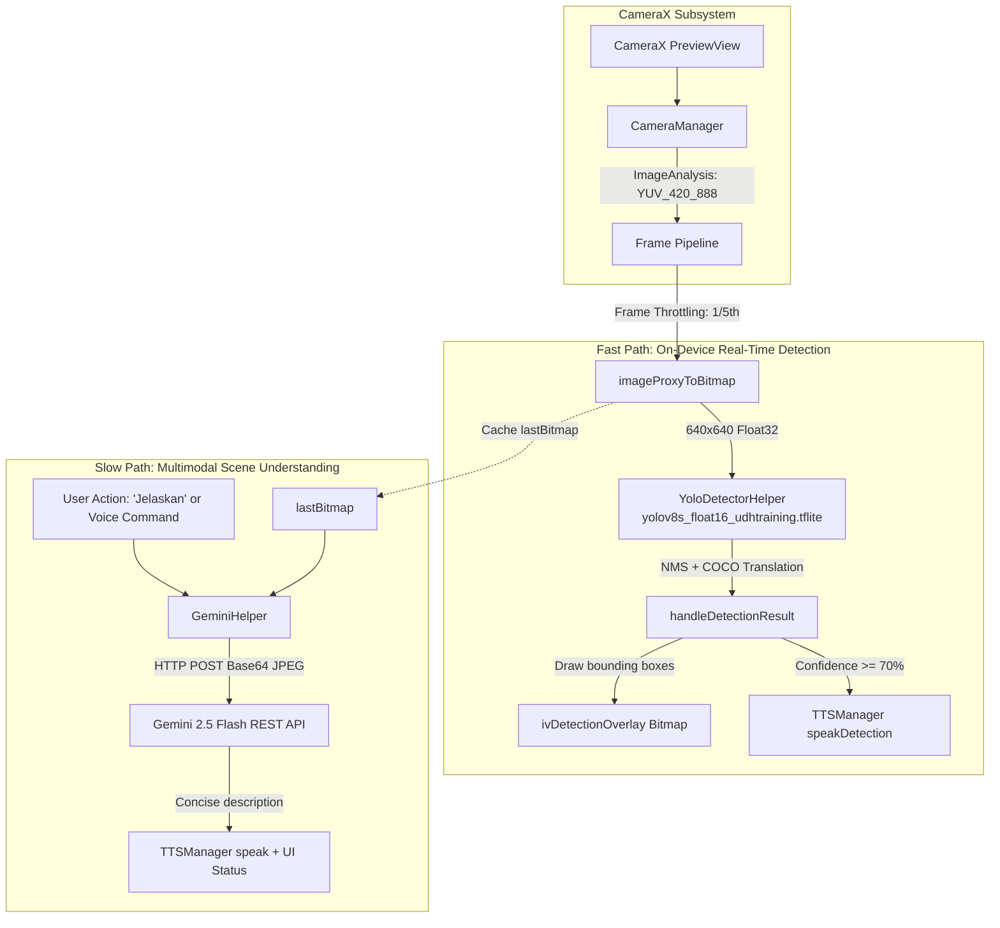

# Orion Navigator — Camera AI Feature Architecture & Technical Analysis

---

## 1. Executive Summary

The **Camera AI** feature in Orion Navigator provides real-time environmental perception, obstacle detection, and scene understanding for visually impaired users. It is designed to assist independent indoor mobility by combining:

1. **Fast Path (On-Device Real-Time Object Detection)**: Powered by YOLOv8s compiled for TensorFlow Lite. Runs fully offline on the device CPU with low latency, detecting obstacles and announcing them via Text-to-Speech (TTS).
2. **Slow Path (Cloud Multimodal Scene Description)**: Powered by Google Gemini 2.5 Flash via REST API. When triggered (via button or voice command *"Jelaskan"*), it captures the current camera frame and generates a concise, descriptive scene summary in Indonesian formatted specifically for visually impaired users.

---

## 2. Integration Points in the Application

The Camera AI feature is integrated into two primary user journeys:

| Location | Component | Role & Functionality |
| :--- | :--- | :--- |
| **Standalone Feature** | [`CameraAIActivity.kt`](file:///c:/Users/achma/Downloads/Orion/OrionNavigator/OrionNavigator/OrionNavigator/app/src/main/java/com/orion/app/ui/CameraAIActivity.kt) | Dedicated full-screen camera view with real-time detection overlay, "Jelaskan" scene description, voice command support (*"Hello Orion"*), TalkBack accessibility, and sound toggle. Accessible directly from Home (`cardCameraAI`). |
| **Integrated Navigation** | [`DirectionActivity.kt`](file:///c:/Users/achma/Downloads/Orion/OrionNavigator/OrionNavigator/OrionNavigator/app/src/main/java/com/orion/app/ui/DirectionActivity.kt) via [`page_nav_camera.xml`](file:///c:/Users/achma/Downloads/Orion/OrionNavigator/OrionNavigator/OrionNavigator/app/src/main/res/layout/page_nav_camera.xml) | Swipeable ViewPager2 tab alongside turn-by-turn indoor BLE navigation. Allows users to follow step-by-step guidance while the camera continuously monitors obstacles in the user's path. |

---

## 3. High-Level System Architecture



---

## 4. Component Details & Implementation

### 4.1 Camera Manager & Stream
* **File**: [`CameraManager.kt`](file:///c:/Users/achma/Downloads/Orion/OrionNavigator/OrionNavigator/OrionNavigator/app/src/main/java/com/orion/app/camera/CameraManager.kt)
* **Framework**: AndroidX CameraX (`1.2.3`).
* **Aspect Ratio Selection**: Dynamically detects window dimensions to pick `AspectRatio.RATIO_16_9` or `AspectRatio.RATIO_4_3` for natural, distortion-free preview.
* **Analyzer Config**:
  * Backpressure strategy: `ImageAnalysis.STRATEGY_KEEP_ONLY_LATEST`.
  * Output format: `ImageAnalysis.OUTPUT_IMAGE_FORMAT_YUV_420_888`.
  * Executor: Single-threaded background executor.

### 4.2 On-Device ML Pipeline (YOLOv8)
* **File**: [`YoloDetectorHelper.kt`](file:///c:/Users/achma/Downloads/Orion/OrionNavigator/OrionNavigator/OrionNavigator/app/src/main/java/com/orion/app/ml/YoloDetectorHelper.kt)
* **Model**: `yolov8s_float16_udhtraining.tflite` (~22.5 MB) in `app/src/main/assets/`.
* **Execution Details**:
  * TensorFlow Lite interpreter running on **4 CPU threads**.
  * Input tensor: `[1, 640, 640, 3]` (RGB float32 normalized from `0..255` to `0.0..1.0`).
  * Output tensor: `[1, 84, 8400]` (4 bounding box coordinates + 80 COCO class probability scores across 8,400 proposals).
* **Filtering & NMS**:
  * Confidence threshold: `0.50f` (50%).
  * IoU threshold for NMS: `0.50f`.
* **Localization & Output**:
  * 80 COCO classes translated to Indonesian (`person` $\rightarrow$ *Orang*, `chair` $\rightarrow$ *Kursi*, `bottle` $\rightarrow$ *Botol*, etc.).
  * Only predictions with confidence $\ge 70\%$ are read aloud via `TTSManager.speakDetection` with debounce to prevent voice chatter.
  * Bounding boxes and labels are rendered directly onto a transparent `Bitmap` backed by an `ImageView` (`ivDetectionOverlay` / `camDetectionOverlay`).

### 4.3 Multimodal AI (Google Gemini 2.5 Flash)
* **File**: [`GeminiHelper.kt`](file:///c:/Users/achma/Downloads/Orion/OrionNavigator/OrionNavigator/OrionNavigator/app/src/main/java/com/orion/app/gemini/GeminiHelper.kt)
* **API Mechanism**: Lightweight direct REST communication via `HttpURLConnection` without requiring heavy client SDKs.
* **Models**:
  * Primary: `gemini-2.5-flash`
  * Fallback: `gemini-2.5-flash-lite` (with automatic 5-second wait if rate-limited by HTTP 429).
* **System Prompt**:
  > *"Beritahu tuna netra apa yang ada di depan kamera dengan kalimat pendek dan informatif. Gunakan awalan 'Ada...' atau 'Terlihat...'. LANGSUNG deskripsikan objeknya. JANGAN pakai kata pembuka seperti 'Tentu', 'Berikut adalah', atau 'Gambar ini menunjukkan'. Cukup katakan apa yang terlihat. Contoh: 'Ada botol air mineral tutup biru di tengah meja.'"*
* **UX Feedback**: Plays periodic audio beeps using `ToneGenerator` while processing, then reads the response aloud via TTS and shows it on screen.

### 4.4 Voice Commands & Wake Word
* Integrated with Vosk offline speech recognition and `GeminiCommandProcessor`:
  * Wake word: *"Hello Orion"*
  * Voice intents handled:
    * `DESCRIBE_SCENE` $\rightarrow$ invokes Gemini scene description.
    * `TOGGLE_SOUND_ON` / `TOGGLE_SOUND_OFF` $\rightarrow$ controls TTS audio feedback.
    * `GO_BACK` $\rightarrow$ navigates back to the previous screen.
    * `HELP` $\rightarrow$ speaks usage instructions.

---

## 5. Technical Observations & Performance Analysis

### 1. Frame Conversion Overhead (`imageProxyToBitmap`)
* **Current Implementation**:
  ```kotlin
  ImageProxy (YUV) -> NV21 ByteArray -> YuvImage.compressToJpeg() -> BitmapFactory.decodeByteArray() -> Matrix rotate -> Bitmap
  ```
* **Bottleneck**: Performing JPEG compression and immediate decompression on the CPU every 5 frames causes substantial GC pressure, CPU load, and latency.
* **Recommended Fix**: Use direct YUV-to-RGB conversion (such as AndroidX `ImageProxy.toBitmap()` in updated CameraX libraries, or a native / ScriptIntrinsic YUV-to-RGB converter).

### 2. Code Duplication Between Activities
* Detection handling, frame parsing, bounding box calculations, and Gemini calls are duplicated between [`CameraAIActivity.kt`](file:///c:/Users/achma/Downloads/Orion/OrionNavigator/OrionNavigator/OrionNavigator/app/src/main/java/com/orion/app/ui/CameraAIActivity.kt) and [`DirectionActivity.kt`](file:///c:/Users/achma/Downloads/Orion/OrionNavigator/OrionNavigator/OrionNavigator/app/src/main/java/com/orion/app/ui/DirectionActivity.kt).
* **Recommended Fix**: Extract shared vision and inference logic into a reusable controller/use-case (e.g. `VisionEngine` or `CameraAIManager`).

### 3. Lack of Spatial & Distance Awareness
* Currently, the app announces *what* is seen (e.g., *"Kursi 85%"*), but does not inform the user *where* it is relative to their path (*"di depan"*, *"di kiri"*, *"di kanan"*) or approximate distance (*"dekat"*, *"sedang"*, *"jauh"*).
* **Recommended Fix**: Use bounding box horizontal center (`(x1 + x2) / 2`) and box area / height relative to frame height to derive spatial direction and proximity cues.

### 4. Hardware Acceleration & Model Footprint
* Currently running `yolov8s_float16` (~22.5 MB) on 4 CPU threads.
* For entry-level Android devices, switching to a lightweight model like YOLOv8n (nano, ~6 MB) or enabling the GPU Delegate / NNAPI will significantly lower battery consumption and improve inference FPS.

### 5. Redundant Custom View
* [`DetectionOverlayView.kt`](file:///c:/Users/achma/Downloads/Orion/OrionNavigator/OrionNavigator/OrionNavigator/app/src/main/java/com/orion/app/camera/DetectionOverlayView.kt) is not used in layouts (the app uses standard `ImageView` overlays). It can either be integrated or safely retired to reduce dead code.

---

## 6. Actionable Development Roadmap

| Phase | Task | Impact / Goal |
| :---: | :--- | :--- |
| **Phase 1** | **Optimize Frame Pipeline** | Replace JPEG encode-decode with direct YUV-to-Bitmap conversion; reduce per-frame latency. |
| **Phase 2** | **Spatial & Distance Guidance** | Calculate bounding box sector (kiri / tengah / kanan) and proximity (dekat / jauh) in TTS announcements. |
| **Phase 3** | **Unify Vision Architecture** | Consolidate duplicate vision logic from `CameraAIActivity` and `DirectionActivity` into a shared engine. |
| **Phase 4** | **Hardware Acceleration & Model Tuning** | Test YOLOv8n (nano) or GPU delegate for improved battery efficiency and lower device temperatures. |
| **Phase 5** | **Gemini Prompt & Offline Fallback** | Add obstacle hazard warnings into Gemini prompts and smooth offline degradation when network is absent. |
