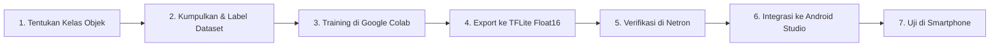

# Panduan Lengkap: Menambahkan Objek Baru & Custom Training YOLOv8 untuk Orion Fast Path

Dokumen ini berisi panduan *end-to-end* (langkah demi langkah) untuk melatih model YOLOv8 kustom dan mengintegrasikannya ke dalam fitur **Fast Path (On-Device Real-Time Object Detection)** pada aplikasi Orion Navigator.

---

## 1. Pemahaman Arsitektur Fast Path Saat Ini

Sebelum memulai, pahami bagaimana model TFLite saat ini bekerja di [`YoloDetectorHelper.kt`](file:///c:/Users/achma/Downloads/Orion/OrionNavigator/OrionNavigator/OrionNavigator/app/src/main/java/com/orion/app/ml/YoloDetectorHelper.kt):

* **Model saat ini**: `yolov8s_float16_udhtraining.tflite` (~22.5 MB) di folder `app/src/main/assets/`.
* **Input Tensor**: `[1, 640, 640, 3]` (RGB Float32 ternormalisasi ke rentang `0.0 .. 1.0`).
* **Output Tensor**: `[1, 84, 8400]`
  * `4` = Koordinat bounding box proposal (`x_center`, `y_center`, `width`, `height`).
  * `80` = Skor probabilitas untuk 80 kelas COCO dataset.
  * `8400` = Jumlah proposal anchor deteksi.
* **Perubahan jika menambah objek baru**:
  Jika Anda melatih model dengan jumlah kelas baru (misal $N$ kelas), bentuk output tensor akan menjadi **`[1, 4 + N, 8400]`**. Anda wajib memperbarui konstanta dan daftar kelas di kode Kotlin.

---

## 2. Roadmap Langkah Eksekusi



---

## 3. Langkah 1: Menentukan Kelas Objek Tambahan

Untuk navigasi tuna netra, prioritaskan objek yang berkaitan dengan **keamanan (hazards)** dan **landmark navigasi**:

| Kelas Objek | Label Inggris (Dataset) | Terjemahan Indonesia | Urgensi |
| :--- | :--- | :--- | :--- |
| **Tangga Turun** | `stairs_down` | *Tangga Turun* | ⚠️ Bahaya Jatuh |
| **Tangga Naik** | `stairs_up` | *Tangga Naik* | ℹ️ Rute |
| **Pintu Tertutup** | `door_closed` | *Pintu Tertutup* | ⚠️ Rintangan |
| **Pintu Terbuka** | `door_open` | *Pintu Terbuka* | ℹ️ Akses Jalan |
| **Tiang / Hambatan Kepala** | `pole` / `pillar` | *Tiang* | ⚠️ Bahaya Tabrakan |
| **Guiding Block (Kuning)** | `tactile_paving` | *Jalur Pemandu* | ℹ️ Navigasi Jalur |
| **Lift / Elevator** | `elevator` | *Lift* | ℹ️ Titik Tujuan |
| **Lantai Licin / Genangan** | `wet_floor` | *Lantai Basah* | ⚠️ Bahaya Terpeleset |

> [!TIP]
> Anda bisa memilih untuk:
> 1. **Melatih model khusus indoor saja** (misal 5 - 10 kelas spesifik navigasi) $\rightarrow$ Model lebih ringan, lebih cepat, dan lebih akurat.
> 2. **Melatih gabungan COCO + kelas kustom** (memerlukan dataset gabungan yang lebih besar).
> *Sangat disarankan memakai opsi 1 atau mempertahankan hanya objek COCO penting (seperti `person`, `chair`, `door`, `stairs`).*

---

## 4. Langkah 2: Pengumpulan & Anotasi Dataset

### Menggunakan Roboflow (Paling Cepat & Standar Industri)
1. Buka [Roboflow Universe](https://universe.roboflow.com/) atau buat project baru di [roboflow.com](https://roboflow.com/).
2. Buat Project baru:
   * **Project Type**: `Object Detection`
   * Masukkan nama kelas objek Anda (misal: `door_closed`, `door_open`, `stairs`, `pillar`).
3. **Kumpulkan Foto**:
   * Ambil foto menggunakan kamera HP dari sudut pandang pejalan kaki (ketinggian dada / tangan).
   * Variasikan pencahayaan (terang, redup, lorong gelap).
   * Minimal: **150 - 300 gambar per kelas** untuk akurasi yang baik.
   * *Opsi cepat:* Cari dataset siap pakai di Roboflow Universe (misal: *"indoor stairs detection"*, *"doors dataset"*).
4. **Label Bounding Box**:
   * Tarik kotak tepat di sekitar objek.
5. **Generate & Export Dataset**:
   * Apply Preprocessing: `Auto-Orient`, `Resize to 640x640`.
   * Apply Augmentation: `Brightness (+/- 15%)`, `Horizontal Flip`.
   * Klik **Export Dataset** $\rightarrow$ Pilih format **`YOLOv8`** $\rightarrow$ Pilih **show download code**.

---

## 5. Langkah 3: Training Model Menggunakan Google Colab (GPU Gratis)

Buka [Google Colab](https://colab.research.google.com/), ubah runtime ke **T4 GPU** (*Runtime $\rightarrow$ Change runtime type $\rightarrow$ T4 GPU*), lalu jalankan kode berikut:

```python
# 1. Install library Ultralytics YOLOv8
!pip install ultralytics

# 2. Cek ketersediaan GPU
import torch
print(f"CUDA available: {torch.cuda.is_available()}, Device: {torch.cuda.get_device_name(0)}")

# 3. Download dataset dari Roboflow (paste curl / roboflow code Anda di sini)
!pip install roboflow
from roboflow import Roboflow
rf = Roboflow(api_key="PASTE_YOUR_ROBOFLOW_API_KEY")
project = rf.workspace("YOUR_WORKSPACE").project("YOUR_PROJECT")
version = project.version(1)
dataset = version.download("yolov8")

# 4. Mulai Training
from ultralytics import YOLO

# Rekomendasi model:
# - 'yolov8n.pt' (Nano): Sangat ringan (~6 MB), FPS tinggi di HP, cocok untuk mobile!
# - 'yolov8s.pt' (Small): Sedang (~22 MB), sedikit lebih akurat namun lebih berat di CPU.
model = YOLO('yolov8n.pt') 

results = model.train(
    data=f"{dataset.location}/data.yaml",
    epochs=60,         # 50 - 100 epoch biasanya cukup
    imgsz=640,         # Wajib 640 sesuai pipeline CameraX
    batch=16,          # Sesuaikan VRAM GPU
    patience=15,       # Early stopping jika tidak ada peningkatan
    save=True,
    device=0
)
```

---

## 6. Langkah 4: Export Model ke Format TensorFlow Lite (`.tflite`)

Setelah training selesai, file bobot terbaik tersimpan di `runs/detect/train/weights/best.pt`. Export langsung ke TFLite dengan format **Float16** (kompatibel dengan interpreter Orion saat ini):

```python
from ultralytics import YOLO

# Load model hasil training terbaik
best_model = YOLO("runs/detect/train/weights/best.pt")

# Export ke TFLite Float16 (imgsz wajib 640)
exported_file = best_model.export(
    format="tflite",
    half=True,    # Float16 untuk ukuran compact dan hemat memori
    imgsz=640
)

print("File berhasil di-export ke:", exported_file)
```

File hasil export akan berada di: `runs/detect/train/weights/best_saved_model/best_float16.tflite`.
Download file ini ke komputer Anda, lalu ganti namanya (misal: `orion_custom_yolov8n.tflite`).

---

## 7. Langkah 5: Verifikasi Output Model dengan Netron

Buka browser dan buka [https://netron.app](https://netron.app):
1. Drag & drop file `.tflite` baru Anda.
2. Klik node **Input**:
   * Pastikan dimensi input bertuliskan: `[1, 640, 640, 3]`, tipe `float32`.
3. Klik node **Output**:
   * Lihat dimensinya: Harus berbentuk `[1, 4 + N, 8400]` di mana $N$ adalah jumlah kelas objek Anda!
   * *Contoh:* Jika Anda memiliki 10 kelas baru, dimensinya adalah `[1, 14, 8400]`.

---

## 8. Langkah 6: Integrasi ke Android Codebase Orion

### 8.1. Masukkan Model ke Assets
1. Salin file `.tflite` baru Anda ke folder:
   ```text
   OrionNavigator/app/src/main/assets/orion_custom_yolov8n.tflite
   ```

### 8.2. Update [`YoloDetectorHelper.kt`](file:///c:/Users/achma/Downloads/Orion/OrionNavigator/OrionNavigator/OrionNavigator/app/src/main/java/com/orion/app/ml/YoloDetectorHelper.kt)

Buka [`YoloDetectorHelper.kt`](file:///c:/Users/achma/Downloads/Orion/OrionNavigator/OrionNavigator/OrionNavigator/app/src/main/java/com/orion/app/ml/YoloDetectorHelper.kt) dan lakukan perubahan berikut:

#### 1. Ubah konstanta file & jumlah kelas:
```kotlin
companion object {
    private const val TAG = "YoloDetectorHelper"
    // Ganti nama model ke file baru Anda
    private const val MODEL_FILE = "orion_custom_yolov8n.tflite"
    
    // Ganti daftar kelas SESUAI URUTAN pada file data.yaml saat training!
    private val LABELS = listOf(
        "stairs_down",
        "stairs_up",
        "door_closed",
        "door_open",
        "pillar",
        "person",
        "chair"
    )

    // Terjemahan Bahasa Indonesia untuk TTS dan Bounding Box
    private val labelTranslations = mapOf(
        "stairs_down" to "Tangga Turun",
        "stairs_up" to "Tangga Naik",
        "door_closed" to "Pintu Tertutup",
        "door_open" to "Pintu Terbuka",
        "pillar" to "Tiang",
        "person" to "Orang",
        "chair" to "Kursi"
    )
}
```

#### 2. Sesuaikan konfigurasi di constructor class:
```kotlin
// YOLO configuration
private val inputSize = 640
// Otomatis mengikuti panjang list LABELS baru
private val numClasses = LABELS.size 
private val numProposals = 8400
private val confidenceThreshold = 0.50f
private val iouThreshold = 0.5f

// Output tensor shape dinamis mengikuti numClasses
private val outputShape = intArrayOf(1, 4 + numClasses, numProposals)
private val outputBuffer = Array(1) { 
    Array(4 + numClasses) { 
        FloatArray(numProposals) 
    } 
}
```

#### 3. Update pemetaan label di `postprocessOutput`:
Ganti `COCO_CLASSES` dengan list kelas baru `LABELS`:
```kotlin
// Ganti baris pemetaan label:
DetectionResult(
    label = LABELS.getOrElse(detection.classId) { "Objek Tidak Dikenal" },
    confidence = detection.confidence,
    boundingBox = RectF(
        detection.x1 * scaleX,
        detection.y1 * scaleY,
        detection.x2 * scaleX,
        detection.y2 * scaleY
    )
)
```

---

## 9. Langkah 7: Rekomendasi Peringatan Suara Cerdas (Safety Priority)

Untuk objek berbahaya seperti tangga turun atau pintu tertutup, tambahkan logika peringatan prioritas tinggi di [`CameraAIActivity.kt`](file:///c:/Users/achma/Downloads/Orion/OrionNavigator/OrionNavigator/OrionNavigator/app/src/main/java/com/orion/app/ui/CameraAIActivity.kt):

```kotlin
// Contoh kustomisasi di handleDetectionResult()
val hazardObjects = setOf("Tangga Turun", "Pintu Tertutup", "Tiang")

if (indonesianLabel in hazardObjects && confidence >= 0.60f) {
    // Beri peringatan bahaya darurat
    ttsManager?.speak("Awas! Ada $indonesianLabel di depan Anda!")
} else if (confidence >= 0.70f) {
    ttsManager?.speakDetection(indonesianLabel)
}
```

---

## 10. Checklist Sebelum Rilis / Testing

- [ ] File `.tflite` sudah ada di `app/src/main/assets/`.
- [ ] Nama file di `MODEL_FILE` sudah sama persis.
- [ ] Urutan list `LABELS` di Kotlin sama persis dengan urutan `names` di `data.yaml`.
- [ ] `numClasses = LABELS.size` terhubung ke dimensi output buffer `4 + numClasses`.
- [ ] Terjemahan di `labelTranslations` lengkap.
- [ ] Diuji di smartphone: pastikan tidak ada log `IllegalArgumentException` pada TensorFlow Lite Interpreter.
