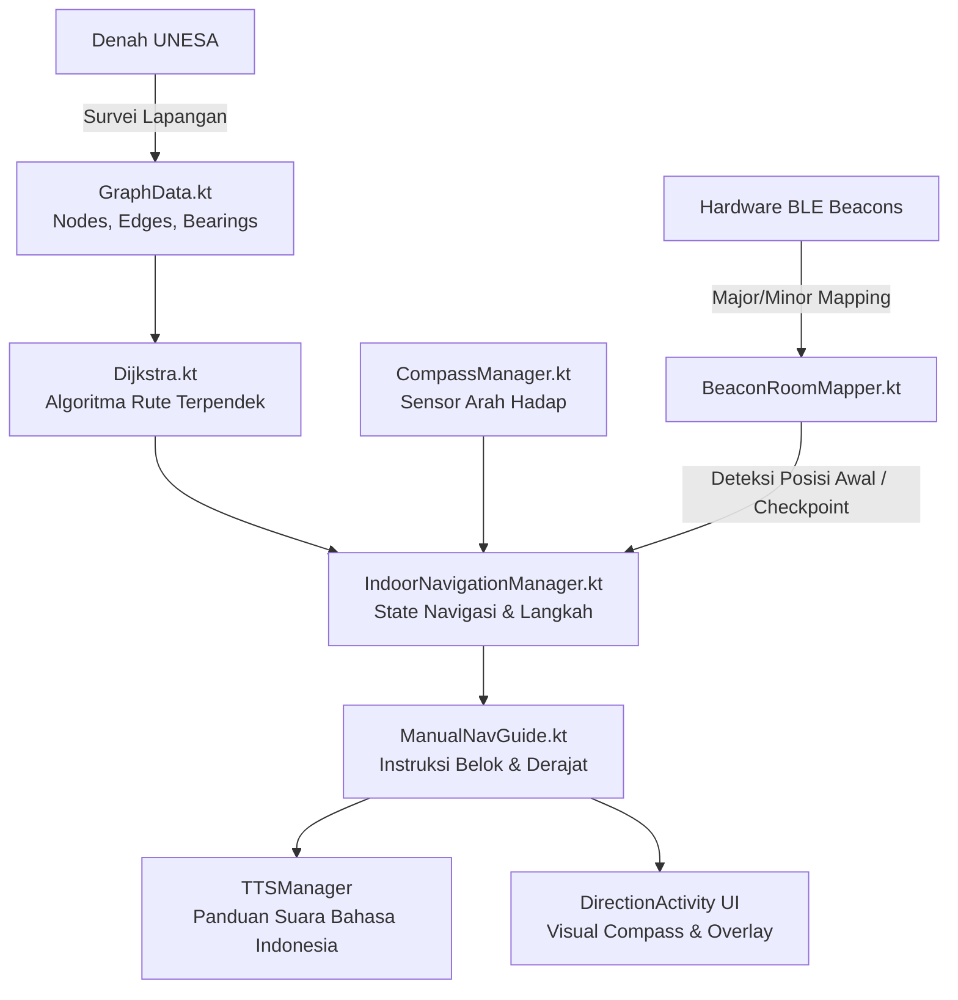

# 🧭 Orion Navigator — UNESA Indoor Navigation Migration Plan

Dokumen ini berisi panduan lengkap langkah demi langkah (*step-by-step*) untuk memigrasikan sistem navigasi dalam ruangan (*indoor navigation*) Orion Navigator dari lokasi awal (**YPAB Surabaya**) ke gedung baru di **UNESA (Universitas Negeri Surabaya)**.

---

## 📌 Daftar Isi
1. [Arsitektur Navigasi Orion](#1-arsitektur-navigasi-orion)
2. [Fase 1: Survei Lapangan & Pengumpulan Data (Di Gedung UNESA)](#fase-1-survei-lapangan--pengumpulan-data-di-gedung-unesa)
3. [Fase 2: Template Pengumpulan Data](#fase-2-template-pengumpulan-data)
4. [Fase 3: Modifikasi Kode Program (Android App)](#fase-3-modifikasi-kode-program-android-app)
5. [Fase 4: Pilihan Arsitektur (Replace vs Multi-Building)](#fase-4-pilihan-arsitektur-replace-vs-multi-building)
6. [Fase 5: Pengujian & Kalibrasi Lapangan](#fase-5-pengujian--kalibrasi-lapangan)

---

## 1. Arsitektur Navigasi Orion

Sebelum melakukan perubahan, pahami bagaimana komponen navigasi Orion saling terhubung:



### File Utama yang Terlibat:
| File | Lokasi | Peran | Perlu Diubah? |
|---|---|---|:---:|
| `GraphData.kt` | `com.orion.app.navigation` | Menyimpan daftar ruangan, persimpangan, jarak langkah, dan bearing kompas | **YA (Wajib)** |
| `BeaconRoomMapper.kt` | `com.orion.app.navigation` | Memetakan hardware beacon (Major, Minor) ke Node ID | **YA (Wajib)** |
| `Dijkstra.kt` | `com.orion.app.navigation` | Algoritma pathfinding | *Tidak* (Otomatis) |
| `IndoorNavigationManager.kt` | `com.orion.app.navigation` | Logika navigasi turn-by-turn | *Tidak* (Otomatis) |
| `ManualNavGuide.kt` | `com.orion.app.navigation` | Kalkulasi arah belok hadap kiri/kanan | *Tidak* (Otomatis) |
| `DirectionActivity.kt` | `com.orion.app.ui` | UI layar navigasi & dropdown tujuan | *Tidak* (Otomatis) |

---

## Fase 1: Survei Lapangan & Pengumpulan Data (Di Gedung UNESA)

Langkah awal harus dilakukan langsung di lokasi gedung UNESA yang akan dipetakan.

### Langkah 1.1: Pembuatan Sketsa Denah & Penentuan Node
1. Gambar denah lantai gedung UNESA (misalnya Gedung Rektorat Lt. 1 atau Gedung FT).
2. Tentukan 2 jenis titik (**Node**):
   * **Destination Nodes (Tujuan/Ruangan)**: Ruangan yang bisa dikunjungi user tunanetra.
     * *Contoh*: Ruang Dosen, Lab Komputer, Toilet Pria, Toilet Wanita, Dekanat, Tangga, Lift, Pintu Keluar.
   * **Junction Nodes (Titik Persimpangan/Koridor)**: Titik belokan atau pertigaan di koridor jalan.
     * *Contoh*: Depan Lift, Pertigaan Lorong Barat, Tikungan Lab.
3. Berikan penomoran ID integer unik pada setiap node:
   * Disarankan: `1 - 99` untuk Junction Nodes, `101 - 199` untuk Destination Nodes.

### Langkah 1.2: Pengukuran Langkah (*Step Count*)
1. Berjalanlah dengan langkah kaki normal orang dewasa antara dua titik yang terhubung langsung ($A \rightarrow B$).
2. Hitung jumlah langkahnya (misal: 14 langkah).

### Langkah 1.3: Pengukuran Derajat Arah Hadap (*Compass Bearing*)
Arah hadap dinyatakan dalam derajat kompas ($0^\circ - 359^\circ$):
* $0^\circ$ / $360^\circ$ = Utara
* $90^\circ$ = Timur
* $180^\circ$ = Selatan
* $270^\circ$ = Barat

**Cara Mengukur:**
1. Berdiri di **Titik A**, hadapkan tubuh persis ke arah jalur menuju **Titik B**.
2. Buka aplikasi kompas (bisa gunakan menu *Compass Test* di aplikasi Orion).
3. Catat derajatnya (misal: $275^\circ$).
4. Berdiri di **Titik B**, putar balik menghadap ke **Titik A**, lalu catat derajat baliknya (misal: $95^\circ$).

### Langkah 1.4: Pemasangan & Pencatatan BLE Beacon
1. Pasang beacon fisik di setiap ruangan tujuan atau checkpoint penting (tinggi ideal: 1.5 - 2 meter dari lantai, hindari tertutup logam tebal).
2. Catat identitas beacon:
   * **UUID**: UUID iBeacon (biasanya sama untuk satu set beacon).
   * **Major**: ID Gedung / Kelompok (misal: 2).
   * **Minor**: ID Unik Ruangan (misal: 101, 102, dst).

---

## Fase 2: Template Pengumpulan Data

Gunakan tabel di bawah ini saat survei lapangan:

### A. Tabel Node (Titik Lokasi)
| Node ID | Nama Lokasi (nameSpoken) | Tipe (Destination / Junction) | Catatan Fisik |
|:---:|---|:---:|---|
| 1 | Pertigaan Pintu Masuk | Junction | Depan pintu lobi utama |
| 2 | Lorong Depan Lift | Junction | Samping tangga |
| 101 | Ruang Tata Usaha | Destination | Pintu kayu cokelat |
| 102 | Laboratorium Komputer | Destination | Pintu kaca |
| 103 | Toilet Mahasiswa | Destination | Dekat lorong barat |

### B. Tabel Edge (Koneksi Antar Titik)
| Dari (Node ID) | Ke (Node ID) | Langkah (steps) | Arah Kompas (bearing) | Deskripsi |
|:---:|:---:|:---:|:---:|---|
| 1 | 2 | 12 | 90.0° | Lurus dari pintu masuk ke lorong lift |
| 2 | 1 | 12 | 270.0° | Balik dari lorong lift ke pintu masuk |
| 2 | 101 | 5 | 180.0° | Belok kanan dari lift masuk ke TU |
| 101 | 2 | 5 | 0.0° | Keluar dari TU menuju lorong lift |
| 2 | 102 | 18 | 90.0° | Lanjut lurus dari lift ke Lab Komputer |
| 102 | 2 | 18 | 270.0° | Dari Lab Komputer kembali ke lift |

### C. Tabel Beacon Mapping
| Major | Minor | Node ID | Nama Ruangan | Keterangan Beacon |
|:---:|:---:|:---:|---|---|
| 2 | 1 | 101 | Ruang Tata Usaha | Beacon ditempel di kusen pintu |
| 2 | 2 | 102 | Laboratorium Komputer | Beacon di samping scanner absensi |
| 2 | 3 | 103 | Toilet Mahasiswa | Beacon di dinding luar toilet |

---

## Fase 3: Modifikasi Kode Program (Android App)

Setelah data survei diperoleh, lakukan modifikasi pada file berikut:

### 1. Edit `GraphData.kt`
Buka: `app/src/main/java/com/orion/app/navigation/GraphData.kt`

#### A. Ganti `junctionNodes` & `destinationNodes`:
```kotlin
// ========== JUNCTION NODES UNESA ==========
private val junctionNodes = mapOf(
    1 to Node(1, "Pertigaan Pintu Masuk"),
    2 to Node(2, "Lorong Depan Lift"),
    3 to Node(3, "Koridor Sayap Barat")
    // Masukkan semua junction node UNESA
)

// ========== DESTINATION NODES UNESA ==========
private val destinationNodes = mapOf(
    101 to Node(101, "Ruang Tata Usaha", isDestination = true),
    102 to Node(102, "Laboratorium Komputer", isDestination = true),
    103 to Node(103, "Toilet Mahasiswa", isDestination = true),
    104 to Node(104, "Ruang Dekanat", isDestination = true)
    // Masukkan semua destination node UNESA
)
```

#### B. Ganti `edges`:
```kotlin
val edges: List<Edge> = listOf(
    // Area Pintu Masuk & Lift
    Edge(from = 1, to = 2, steps = 12, bearing = 90.0),
    Edge(from = 2, to = 1, steps = 12, bearing = 270.0),

    // Lift ke TU
    Edge(from = 2, to = 101, steps = 5, bearing = 180.0),
    Edge(from = 101, to = 2, steps = 5, bearing = 0.0),

    // Lift ke Lab Komputer
    Edge(from = 2, to = 102, steps = 18, bearing = 90.0),
    Edge(from = 102, to = 2, steps = 18, bearing = 270.0)
    // Masukkan semua edge UNESA bolak-balik
)
```

#### C. Sesuaikan `destinationAliases` (Untuk Voice Command):
Tambahkan sinonim atau pengucapan alternatif bahasa Indonesia / istilah kampus agar user tunanetra mudah memilih tujuan dengan suara:
```kotlin
private val destinationAliases = mapOf(
    "tu" to "ruang tata usaha",
    "tata usaha" to "ruang tata usaha",
    "lab" to "laboratorium komputer",
    "lab kom" to "laboratorium komputer",
    "komputer" to "laboratorium komputer",
    "dekanat" to "ruang dekanat",
    "dekan" to "ruang dekanat",
    "toilet" to "toilet mahasiswa",
    "wc" to "toilet mahasiswa",
    "kamar mandi" to "toilet mahasiswa"
)
```

---

### 2. Edit `BeaconRoomMapper.kt`
Buka: `app/src/main/java/com/orion/app/navigation/BeaconRoomMapper.kt`

#### A. Sesuaikan UUID Beacon:
Jika beacon di UNESA menggunakan UUID yang berbeda dari YPAB, perbarui UUID di bagian dokumentasi/filter atau pastikan beacon memancarkan UUID yang dikenali scanner:
```kotlin
// Format UUID Beacon (jika ada filtering)
const val BEACON_UUID = "0112233445566778899AABBCCDDEEFF0"
```

#### B. Hubungkan Pasangan `(Major, Minor)` ke `Node ID` UNESA:
```kotlin
private val beaconToNodeMap = mapOf(
    Pair(2, 1) to 101,  // Major 2, Minor 1 -> Ruang Tata Usaha (Node 101)
    Pair(2, 2) to 102,  // Major 2, Minor 2 -> Laboratorium Komputer (Node 102)
    Pair(2, 3) to 103   // Major 2, Minor 3 -> Toilet Mahasiswa (Node 103)
    // Pasangkan semua beacon yang dipasang di UNESA
)
```

---

## Fase 4: Pilihan Arsitektur (Replace vs Multi-Building)

Ada dua pendekatan untuk menerapkan perubahan ini:

### Opsi A: Ganti Langsung (Direct Replacement) — *Paling Cepat*
* **Kelebihan**: Cukup edit langsung `GraphData.kt` dan `BeaconRoomMapper.kt` seperti di Fase 3.
* **Kekurangan**: Data denah YPAB Surabaya akan terhapus / tertimpa.

### Opsi B: Multi-Building Architecture — *Direkomendasikan untuk Jangka Panjang*
Membuat sistem yang mendukung multi-lokasi (bisa memilih gedung UNESA atau YPAB, atau otomatis mendeteksi berdasarkan Major Beacon):

```
app/src/main/assets/maps/
├── ypab_surabaya.json
└── unesa_gedung_a.json
```

Format JSON denah:
```json
{
  "buildingId": "unesa_gedung_a",
  "buildingName": "Gedung A UNESA",
  "beaconUuid": "0112233445566778899AABBCCDDEEFF0",
  "nodes": [
    { "id": 1, "name": "Pertigaan Pintu Masuk", "isDestination": false },
    { "id": 101, "name": "Ruang Tata Usaha", "isDestination": true }
  ],
  "edges": [
    { "from": 1, "to": 101, "steps": 15, "bearing": 90.0 }
  ],
  "beacons": [
    { "major": 2, "minor": 1, "nodeId": 101 }
  ]
}
```
*Jika memilih Opsi B, beri tahu dan kita akan implementasikan `MapLoader` otomatis tanpa menghapus data YPAB.*

---

## Fase 5: Pengujian & Kalibrasi Lapangan

Setelah kode di-*build* dan di-*install* di HP Android pengujian:

### 1. Kalibrasi Kompas
* Buka menu navigasi di titik awal.
* Lakukan gerakan membentuk angka 8 (*figure-eight motion*) pada HP untuk mengkalibrasi sensor magnetometer.
* Pastikan HP dipegang setinggi dada, mengarah ke depan tubuh.

### 2. Uji Deteksi Beacon
* Dekati salah satu ruangan (misal: Ruang TU).
* Pastikan aplikasi mendeteksi beacon tersebut dan menampilkan/mengucapkan: *"Anda berada di Ruang Tata Usaha"*.
* Pastikan tidak terjadi *flickering* (berganti-ganti ruangan karena sinyal RSSI memantul).

### 3. Uji Rute & Alignment Derajat
* Pilih tujuan (misal: Lab Komputer).
* Dengarkan instruksi awal: *"Hadap [arah] [X] derajat, jalan [Y] langkah"*.
* Berputarlah hingga ponsel bergetar/berbunyi nada lurus (*"Arah sudah tepat"*).
* Jalan sesuai langkah yang diinstruksikan.
* Saat sampai di persimpangan, pastikan instruksi belok berikutnya terpicu dengan benar.

### 4. Uji Perintah Suara
* Ucapkan: *"Hello Orion"* $\rightarrow$ Tunggu nada respons.
* Ucapkan: *"Saya mau ke Lab Komputer"* atau *"Arahkan ke Tata Usaha"*.
* Pastikan aplikasi memilih tujuan yang tepat secara otomatis.

---

## 🚀 Ringkasan Tindakan Anda Selanjutnya

1. Lakukan survei di gedung UNESA menggunakan template pada **Fase 2**.
2. Kumpulkan daftar:
   * Node (nama-nama ruangan & persimpangan)
   * Edge (jumlah langkah & derajat kompas antar titik)
   * Beacon (UUID, Major, Minor untuk tiap ruangan)
3. Berikan data tersebut atau masukkan langsung ke `GraphData.kt` dan `BeaconRoomMapper.kt`.
4. Build APK & uji langsung di lokasi!

